  

  <nobr>
    <!--
--></svg>" width="13.5%" /><!--
--><!--
--></svg>" width="13.5%" /><!--
--><!--
--></svg>" width="13.5%" /><!--
--><!--
--></svg>" width="13.5%" /><!--
-->
  </nobr>

 

#  TryHackMe Standing:

  
  &nbsp;<b>TryHackMe Global Rank:</b> Top 1% (<code>#542</code>)
  &nbsp;&nbsp;|&nbsp;&nbsp;
  
  &nbsp;<b>Completed Rooms:</b> <code>759+</code>
  &nbsp;&nbsp;|&nbsp;&nbsp;
  
  &nbsp;<b>Total Badges:</b> <code>99</code>

  
  &nbsp;&nbsp;
  
  &nbsp;&nbsp;
  
  &nbsp;&nbsp;
  
  &nbsp;&nbsp;
  
  &nbsp;&nbsp;
  
  &nbsp;&nbsp;
  
  &nbsp;&nbsp;
  
  &nbsp;&nbsp;
  

#  Certifications:

  
  &nbsp;
  

  

#  Tech Stack:

  

  

  
  &nbsp;
  
  &nbsp;
  
  &nbsp;
  
  &nbsp;
  
  &nbsp;
  

#  GitHub Stats:

  

 

  

