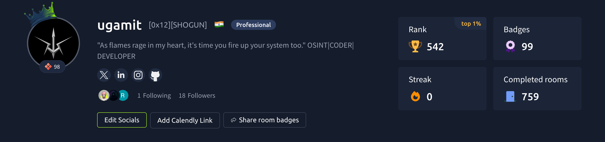
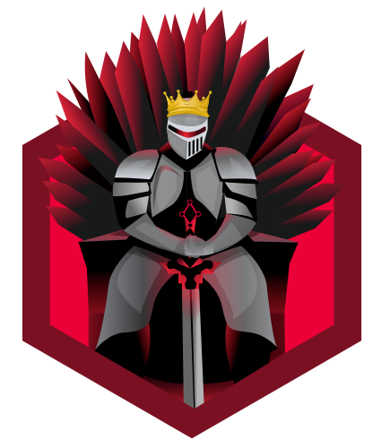
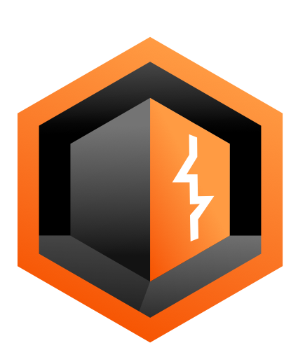
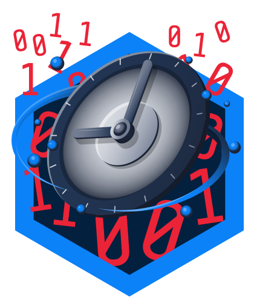
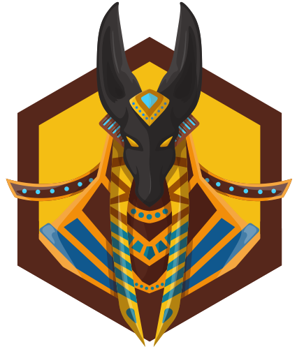
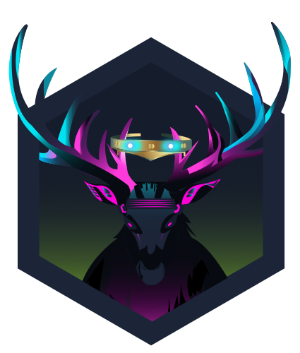
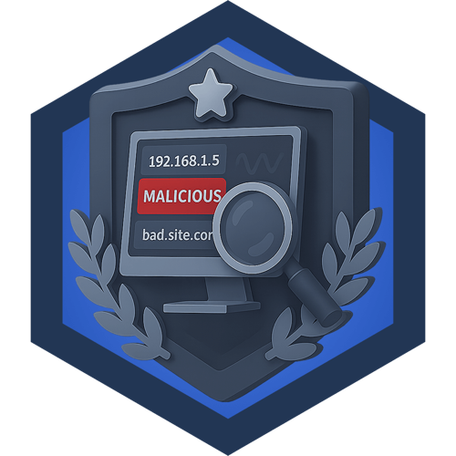
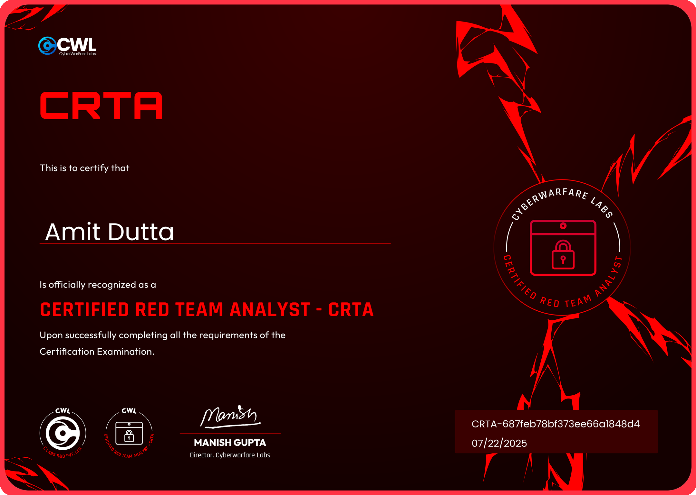
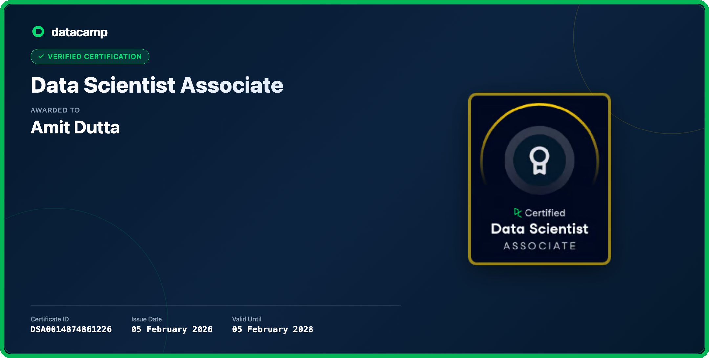
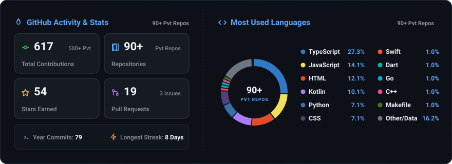

#  About Me:

   

##  Socials:
    

  

  
  &nbsp;<b>TryHackMe Global Rank:</b> Top 1% (<code>#542</code>)
  &nbsp;&nbsp;|&nbsp;&nbsp;
  
  &nbsp;<b>Completed Rooms:</b> <code>759+</code>
  &nbsp;&nbsp;|&nbsp;&nbsp;
  
  &nbsp;<b>Total Badges:</b> <code>99</code>

  
  &nbsp;&nbsp;
  
  &nbsp;&nbsp;
  
  &nbsp;&nbsp;
  
  &nbsp;&nbsp;
  
  &nbsp;&nbsp;
  
  &nbsp;&nbsp;
  
  &nbsp;&nbsp;
  
  &nbsp;&nbsp;
  

#  Tech Stack

#  Certifications:

  
  &nbsp;
  

  

#  LeetCode Achievements:

  
  &nbsp;&nbsp;
  
  
  
  
  
  

#  GitHub Stats:

  

---

